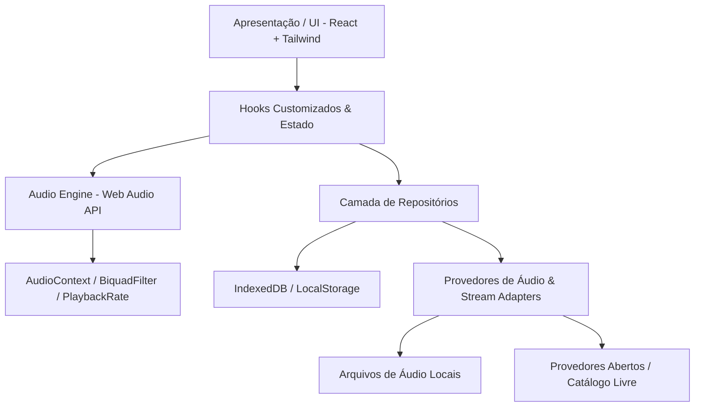

# Arquitetura de Software — Kane

Este documento detalha as decisões técnicas, a topologia de componentes e os padrões de projeto adotados no desenvolvimento do **Kane**, a alternativa livre e open source ao aplicativo Lane.

---

## 1. Princípios Arquiteturais

1. **Independência de Serviços Proprietários**: O Kane não depende de servidores proprietários fechados ou infraestrutura privada da Lane (`laneapi.com`). O aplicativo funciona 100% de forma local e com provedores abertos.
2. **Offline-First & Local-First**: Todas as listas de reprodução, histórico, preferências e faixas salvas residem no armazenamento do dispositivo do usuário (IndexedDB / LocalStorage).
3. **Sem Paywalls ou Restrições Artificiais**: Recursos que exigem pagamento no Lane (como downloads, equalizador completo, sem anúncios) são cidadãos de primeira classe no Kane, livres de cobrança.
4. **Portabilidade & Acessibilidade**: Desenvolvido em **TypeScript**, **React 18/19**, **Vite** e **Tailwind CSS**, permitindo execução direta em navegadores modernos, instalação como Progressive Web App (PWA) em Android e iOS, ou empacotamento desktop (Tauri/Electron).
5. **Código Limpo e Modular**: Separação estrita de responsabilidades inspirada nos princípios da *Clean Architecture*: Domínio (tipos e entidades), Dados (repositórios e adaptadores) e Apresentação (componentes visuais e hooks).

---

## 2. Visão Geral da Arquitetura

---

## 3. Detalhamento dos Componentes

### 3.1 Motor de Áudio (`src/engine/audioEngine.ts`)
O núcleo de processamento sonoro utiliza a **Web Audio API** do W3C para garantir controle sonoro de nível de estúdio:
- **AudioContext & MediaElementSource**: Conecta o elemento de áudio HTML5 ao grafo de áudio Web Audio.
- **Nó de Ganho (`GainNode`)**: Controle preciso de volume e amplificação.
- **Nó de Equalização (`BiquadFilterNode`)**: Grafo serial de filtros paramétricos cobrindo faixas de frequência padrão:
  - 60 Hz (Sub-Bass)
  - 250 Hz (Bass)
  - 1000 Hz (Midrange)
  - 4000 Hz (Upper Midrange)
  - 12000 Hz (Treble)
- **Controle de Velocidade / Efeito Slowed & Speed Up**:
  - Manipulação da propriedade `playbackRate` em tempo real.
  - Alternância de `preservesPitch` para efeitos de estilo *Nightcore* ou *Slowed + Reverb*.

### 3.2 Camada de Domínio (`src/types/index.ts`)
Modelos equivalentes aos identificados na descompilação do Lane:
- `Track`: Identificador único, título, artista, álbum, duração, URL do stream, capa, plataforma de origem e metadados de áudio.
- `Playlist`: ID, título, descrição, capa, data de criação e lista de IDs ou objetos de faixas.
- `TrackEffect`: Configurações ativas de velocidade (`tempo`), tom (`pitch`) e equalizador.
- `Lyrics` & `LyricLine`: Letras estruturadas com marcação de tempo em milissegundos para sincronização.

### 3.3 Camada de Dados e Persistência (`src/services/storage.ts`)
- **Biblioteca Local**: Armazenada no `localStorage` sob schema versionado para playlists, favoritos e histórico de reprodução.
- **Armazenamento de Áudio Offline**: Gerenciado via `IndexedDB` para salvar blobs de faixas para reprodução offline instantânea.

### 3.4 Gerenciamento de Fila de Reprodução (`src/hooks/usePlayer.ts`)
- Lista de faixas ordenada com índice atual.
- Algoritmo de reprodução aleatória (*Shuffle*) Fisher-Yates com histórico de faixas tocadas para possibilitar retrocesso previsível.
- Modos de repetição: `OFF`, `ALL`, `ONE`.

---

## 4. Escolha Tecnológica e Justificativa

| Camada | Tecnologia Escolhida | Justificativa |
|---|---|---|
| **Linguagem** | TypeScript 5.x | Tipagem estática robusta, segurança contra erros de runtime e contratos de API claros. |
| **Framework UI** | React | Ecosistema maduro, ciclo de vida reativo e separação limpa de componentes declarativos. |
| **Build Tool** | Vite | Compilação ultrarrápida, suporte moderno a ESM e empacotamento otimizado. |
| **Estilização** | Tailwind CSS | Sistema de design consistente, suporte imediato a modo escuro e paleta temática neon do Lane. |
| **Ícones** | Lucide React | Pacote moderno, leve e compatível com licenças abertas (ISC/MIT). |
| **Testes** | Vitest | Execução ultrarrápida no ambiente Node com suporte a asserções unitárias completas. |
